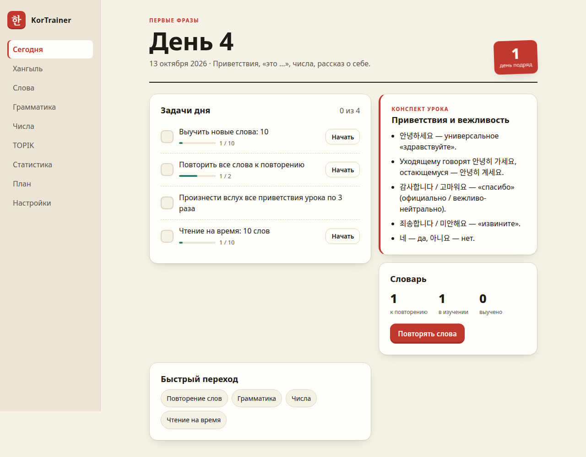
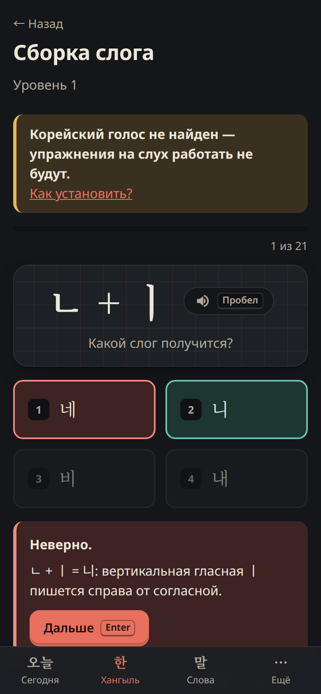
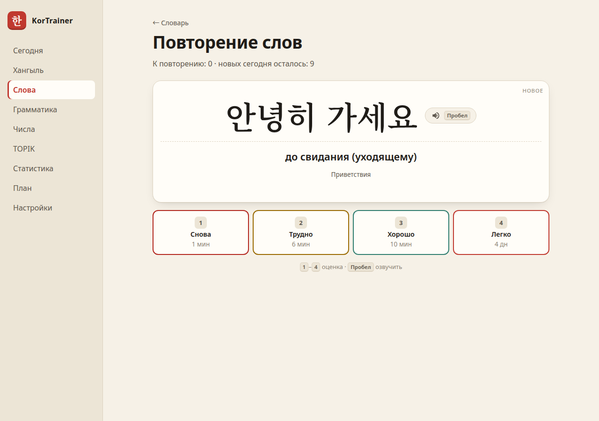
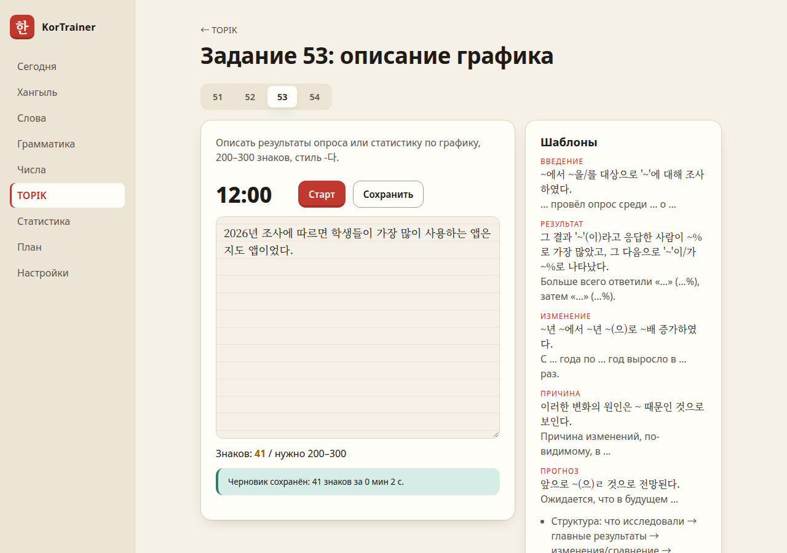

# KorTrainer

A self-study trainer for Korean from absolute zero to **TOPIK in spring 2027**, built as a
clean-architecture ASP.NET Core + Blazor WebAssembly application.

The interface is in Russian (the author's native language); code, comments and docs are in English.
Romanization is **off by default** — the point is to learn to read Hangul without crutches.

| Today (desktop) | Drill (phone, dark theme) | Flashcards |
|---|---|---|
|  |  |  |

## Features

**Iteration 1 (MVP)**

- **A self-paced plan** — the home page shows your current step (a lesson or a block of ~100 words)
  with lesson notes, tasks whose progress is tracked automatically from your answers and accumulates
  for as long as the step is open, manual ticks and quick links. When the tasks are done the app offers
  the next step; "Перейти дальше" is always available. Nothing moves forward just because days pass.
  Instead of a streak it shows how many of the last 7 days had study.
- **«10 минут»** — one tap starts a short session: up to 15 due word cards, five due mistakes, a drill
  from the step's first unfinished task, then a short listening (or letter) drill; everything counts
  towards the step.
- **Работа над ошибками** — a wrong first answer in any multiple-choice drill is kept and comes back
  after 1, 3 and 7 days (a small Leitner schedule); three correct reviews close it, a slip starts over.
- **Hangul**
  - letter → sound and sound → letter, with Russian sound approximations;
  - syllable composition and decomposition computed from Unicode arithmetic (no syllable tables);
  - the three consonant series (가/카/까, 다/타/따, …) by ear via the browser's Korean voice;
  - batchim: the 7 final sounds and pronunciation rules (연음, nasalization, tensification, …);
  - timed reading with milliseconds-per-syllable statistics;
  - a word analyzer that splits syllables into letters and explains how a word is pronounced.
- **Vocabulary with spaced repetition** — an Anki-style SM-2 scheduler (learning steps, ease,
  lapses) over a ~5,900-word deck: ~350 hand-picked words for the first lessons plus all three levels
  (A/B/C) of the official NIKL learner vocabulary list, introduced by frequency as the plan reaches each stage.
- **Keyboard first** — `1`–`4` to answer, `Enter` to continue, `Space` to hear the word.
- Responsive layout (phone tab bar / desktop sidebar), light and dark themes.
- Progress export/import as JSON; data stored in SQLite.

**Iteration 2 — grammar**

- Drills generated from deck words by rule: 이에요/예요, 이/가 아니에요, 은/는, 이/가, 을/를 by batchim;
  -아/어요 with vowel harmony and contraction (가요, 봐요, 마셔요, 돼요), ㅡ-drop (써요, 바빠요) and the
  ㅂ/ㄷ/르/ㅅ/ㅎ irregular classes (더워요, 들어요, 몰라요); -습니다/ㅂ니다 with ㄹ-drop (만듭니다); past -았/었어요;
  stage 2 endings -고, -아서/어서, -(으)니까, -고 싶다, -(으)ㄹ 수 있다, -아/어야 하다.
- TOPIK I grammar (29 topics in all): 와/과 and (으)로 (로 after ㄹ); negation 안/못 (공부 안 해요) and
  -지 않다; future -(으)ㄹ 거예요, -(으)ㄹ게요, -(으)ㄹ까요; honorific -(으)세요 with 드세요/주무세요;
  -아/어 주세요, -고 있다, -지만, -(으)면 (살면 keeps ㄹ), -(으)러 가다, -기 때문에.
- Distractors are the typical learner mistakes (먹아요, 듣어요, 이워요, 먹읍니다, spelling by ear 머거요,
  거에요, 갈께요), never a correct variant such as 바꾸어요; every answer explains the rule that decided it;
  the "mixed" drill only uses topics the plan has opened.
- Grammar in real sentences: deck verbs and nouns are found in their topic's form inside Tatoeba
  sentences made only of words the learner already has, and blanked out (어제 영화를 ___ (보다).). Topic
  drills ask about half their questions this way; «В предложениях» asks only gaps and hides the ending,
  so the form is chosen by meaning among other endings of the same verb, as on TOPIK.

**Iteration 3 — numbers**

- Sino-Korean (no 일 before 십/백/천/만, groups by 만/억) and native numbers (한/두/세/네/스무 before counters),
  counters (개, 명, 살, 권, 잔, 마리, 층, 번 …), clock time (native hours + Sino minutes) and money, in both
  directions; distractors are the classic mistakes (일십오, 일만 원, 사과 삼 개, 삼 시 삼십 분).
- An instant "how to read this number" converter running in the browser on the shared Domain code.

**Iteration 4 — TOPIK and statistics**

- TOPIK II writing (쓰기, tasks 51–54): format, timing split of the 50-minute section, tips and Korean
  phrase templates for the graph description (53) and the essay (54); a countdown timer, a 원고지-style
  character counter with the target range and saved drafts. Past papers are linked on
  [topik.go.kr](https://www.topik.go.kr), not copied.
- Statistics: learned and learning words, accuracy per module (overall and last 7 days), study minutes
  per day (bar chart with hover details and a table view), study days this week and month, reading speed.



**Iteration 5 — practice extras**

- **Listening** — words you are learning are played with nothing on screen: pick the meaning, or pick the
  spelling among sound-alikes generated by rule (other consonant series, ㅓ/ㅗ and ㅜ/ㅡ swaps, another
  batchim) and filtered to ones that really sound different. Native recordings are preferred.
- **Reverse cards** — `?mode=reverse` on the review page shows the Russian side; you type the Korean
  word and get a letter-level diff (wrong vowel, missing batchim) with a suggested grade.
- **Browse the plan** — ← / → on the home page show finished steps with the progress made in them and
  preview upcoming ones; the plan page shows every step of every stage.
- **Forecast** — the statistics page dates each vocabulary goal (800 / 1,500 / 3,000 words) at your
  recent pace (new words over the last 14 days) — a guide, never a deadline.
- **Gentle reminders** — on evenings without study the home page, a systemd user timer on Linux (20:00,
  see [`tools/reminder`](tools/reminder/README.md)) and the Android app suggest ten minutes of practice.
  They can be switched off in the settings.
- **Installable app (PWA)** — a web manifest and a service worker that caches the app shell, recordings
  and the last API answers: the trainer opens in its own window and starts without the server, showing
  the last loaded plan (answers given offline are not saved). Browsers only enable this on `localhost`
  or HTTPS, so a phone opening `http://<computer-ip>:8080` gets the normal online site.

> ⚠️ **The Russian translations in both decks were machine-generated and should be reviewed.**
> Fix them in `src/KorTrainer.Infrastructure/Seed/words.json` or `tools/deck/nikl.ru.tsv` (then run
> `dotnet run tools/deck/BuildNiklDeck.cs`); the next start updates words in place without losing progress.

**Iteration 6 — learning tools**

- **Hanja roots** — 3,200 Sino-Korean deck words carry their hanja (from the NIKL list) and 1,333
  characters have a 훈 and a Russian gloss. `/hanja` lists the roots of the words you study with their
  families (學 학 «учёба» → 학교, 학생, 대학, 방학…); drills ask for the common root of a word family or the
  meaning of a word from its roots. Review cards show a word's roots.
- **Example sentences** — 4,750 short sentences from Tatoeba, each built only from deck words, appear on
  review cards (up to three per word).
- **Dictation and shadowing** — a sentence made of your words is played and you type it, or you repeat it
  aloud and speech recognition checks you (Web Speech API in the browser, Android's recognizer in the app).
  `SentenceComparer` aligns syllables by longest common subsequence, so one missed syllable is one mistake.
- **Keyboard trainer** — the 두벌식 layout row by row, then your words and sentences, with the next key
  highlighted. `HangulComposer` reproduces a Korean keyboard's syllable automaton (patchim moves to the next
  syllable, ㅗ+ㅏ → ㅘ, ㄹ+ㄱ → ㄺ), so no Korean layout has to be installed on the computer.
- **Hard words** — words forgotten twice or answered "Again" three times get a page with roots, examples and
  a personal memory note (kept in backups), plus meaning and sound-alike spelling drills that leave the review
  schedule alone.
- **Reading** — 36 original graded texts from the first phrases to TOPIK II level. Tap a word to see its
  dictionary form (먹었어요 → 먹다), translation and roots, and add it to study; comprehension questions follow.
- **TOPIK I reading** — 135 original items in the exam's formats (31–33 topic, 34–39 cloze, 40–42 notice,
  43–45 same meaning, 46–48 main idea) with explanations and translations.

`WordIndex` links running text to the deck: it generates the stems every deck verb and adjective takes
(via the `Conjugator`: 가/갔/간/갈/가는, 먹어/먹었/먹은/먹을/먹는 …) and matches the longest stem or noun a
token starts with, so particles and endings simply follow. It recognizes 99% of the words in the texts.

### Data sources

- **«한국어 학습용 어휘 목록»** — Korean Learner's Vocabulary List, National Institute of Korean Language
  (국립국어원), 2003: headwords, parts of speech, hanja, levels and frequency ranks. Used under
  [KOGL Type 1](https://www.kogl.or.kr/info/licenseType1.do) (공공누리 제1유형, attribution). See
  [`tools/deck`](tools/deck/README.md) for the export and the build script.
- **Lingua Libre** pronunciation recordings via Wikimedia Commons — CC0 and CC BY-SA 4.0, author and
  license of every file on the in-app `/credits` page.
- **Tatoeba** example sentences — [CC BY 2.0 FR](https://creativecommons.org/licenses/by/2.0/fr/); sentence
  ids and authors are kept and shown. Russian for sentences without a Tatoeba translation is machine-made
  (marked *). Profanity, violence and politics are filtered out (`tools/sentences/excluded.txt`).
- **Unihan** (© Unicode, Inc., Unicode License v3) — English definitions used as hints for the Russian
  hanja glosses, which are machine-written.
- Reading texts and TOPIK I items are original; they are not copied from real exams.

## Quick start

```bash
docker compose up --build          # or: podman compose up --build
```

Open <http://localhost:8080>. From a phone on the same network use `http://<computer-ip>:8080`.
Data lives in the `kortrainer-data` volume (`/data/kortrainer.db`).

> 🔒 KorTrainer is a single-user app **without authentication**: anyone who can reach the port can
> read and replace your progress (including the import endpoint). Run it on a trusted home network
> only, or bind it to localhost by changing the port mapping to `"127.0.0.1:8080:8080"`.

Without Docker (requires the .NET 10 SDK):

```bash
dotnet run --project src/KorTrainer.Api      # http://localhost:5116, DB in src/KorTrainer.Api/data/
```

### Android app

The phone version is a real APK: the same pages, but the database and all logic live on the phone, so
it works without the server and offline (recordings are downloaded on first play). Build it with
`tools/android/build-apk.sh` — setup, signing and moving your progress are described in
[`tools/android`](tools/android/README.md).

### Native-speaker recordings

About 930 words — including the minimal pairs of the plain/aspirated/tense listening drill (바다/파다,
비/피, 덜다/털다/떨다 …) — are voiced by real native speakers from [Lingua Libre](https://lingualibre.org)
(CC0 / CC BY-SA, credited on the `/credits` page). The server downloads each file from Wikimedia
once, caches it in the data volume and prefetches the rest in the background; see
[`tools/audio`](tools/audio/README.md). They are off by default (Settings → «Записи носителей»), so every
word and sentence is spoken by the same MeloTTS voice; turned on, they replace it where they exist.

### Korean voice

Listening drills use the [Web Speech API](https://developer.mozilla.org/docs/Web/API/SpeechSynthesis)
with a `ko-KR` voice — no paid services. If the browser has no Korean voice, the app shows
platform-specific installation instructions (Android: Google TTS → Korean; Windows: Settings → Speech;
macOS/iOS: Spoken Content → Yuna; Linux: Chrome has the online “Google 한국의” voice).

## Architecture

```
src/
  KorTrainer.Domain          pure C#: Hangul, pronunciation, SRS, study plan, exercise generators
  KorTrainer.Contracts       DTOs shared by the API and the Blazor client
  KorTrainer.Application     use cases (Today, Vocabulary, Hangul, Activity, Progress), validation
  KorTrainer.Infrastructure  EF Core + SQLite, migrations, deck seeding
  KorTrainer.Api             Minimal API, ProblemDetails, rate limiting; hosts the WASM client
  KorTrainer.UI              Razor class library: every page and component, CSS, JS interop
  KorTrainer.Web             Blazor WebAssembly host: HTTP client, Web Speech, PWA
  KorTrainer.Embedded        the back end in-process (IKorTrainerApi over the services) for the app
  KorTrainer.Mobile          .NET MAUI Android app: BlazorWebView, Android TTS, reminders
tests/
  KorTrainer.Domain.Tests        unit tests of the language and scheduling logic
  KorTrainer.Application.Tests   services against a migrated in-memory SQLite database
  KorTrainer.Api.Tests           HTTP integration tests with WebApplicationFactory
  KorTrainer.Embedded.Tests      the app's in-process back end on a real SQLite file
```

Dependencies point inwards: `Api → Infrastructure → Application → Domain`. The Domain project has
no dependencies, so the same code runs on the server, inside the browser (the client uses it
for romanization) and on the phone. The pages only know `IKorTrainerApi`, `ISpeechOutput` and
`IBackupExporter`: the web host implements them with HTTP and the Web Speech API, the Android app
with direct service calls and the system text-to-speech engine.

### Interesting bits

- **Unicode syllable math** — `Syllable.Decompose` computes
  `initial = (code − 0xAC00) / 588`, `medial = (code − 0xAC00) % 588 / 28`, `final = (code − 0xAC00) % 28`;
  a syllable has batchim when `(code − 0xAC00) % 28 != 0`. A test round-trips all 11,172 syllables.
- **Pronunciation engine** — `Pronunciation.Pronounce("감사합니다")` → `[감사함니다]` and reports which
  rules fired; the explanations in the drills come from that list. Romanization follows the
  Revised Romanization rules on top of it (`학교` → `hakgyo`).
- **SM-2 scheduler** — a pure function `Schedule(CardState, Grade, now) → CardState` over an
  immutable record; the UI shows the next interval for every answer, as in Anki.
- **Plan-driven unlocking** — lessons 1–3 drill Hangul only; lesson words open from lesson 4; stage words
  and grammar topics open with the blocks that introduce them. The current step is the one open
  `PlanStepProgress` row and its tasks count activity inside its time window. Activity records store
  the learner's local date, so daily statistics are plain SQL `GROUP BY` without time zone math.
- **Deterministic generators** — every drill is generated from rules with an injected `Random`,
  so tests can assert properties over hundreds of generated items.

## API

| Method | Route | Purpose |
|---|---|---|
| GET/PUT | `/api/settings` | start date, time zone, romanization, theme, limits |
| GET | `/api/today?step=` | a plan step (the current one by default), tasks with progress, study days, vocabulary |
| POST | `/api/plan/advance` | finish the current step (`{ "from": key }`, 409 if it already changed) and open the next |
| GET | `/api/reminder` | whether to nudge the learner today, with title and message |
| GET | `/api/plan` | stages and lessons |
| PUT | `/api/today/tasks/{key}` | manual tick |
| GET | `/api/hangul/exercises/{type}?level=&count=` | generated multiple-choice drills |
| GET | `/api/hangul/reading?level=&count=` | words for timed reading |
| POST | `/api/hangul/reading-trials` | reading result |
| GET | `/api/hangul/analyze?text=` | syllable breakdown and pronunciation |
| GET | `/api/vocab/queue` · POST `/api/vocab/reviews` | SRS queue and answers |
| GET | `/api/grammar/topics` · `/api/grammar/exercises/{type\|mixed}?count=` | grammar topics and drills |
| GET | `/api/listening/exercises/{listen-meaning\|listen-spelling}?count=` | listening drills |
| GET | `/api/numbers/exercises/{sino\|native\|counter\|time\|money\|mixed}?count=` | number drills |
| GET | `/api/vocab/summary` · `/api/vocab/words` · `/api/vocab/topics` | vocabulary browser |
| POST | `/api/attempts` · `/api/sessions` | activity log |
| GET | `/api/topik/writing` · GET/POST `/api/topik/drafts` | TOPIK writing guide and drafts |
| GET | `/api/stats/overview` · `/api/stats/daily?days=` · `/api/stats/forecast` | statistics and goal forecast |
| GET | `/api/hanja/roots` · `/api/hanja/roots/{char}` · `/api/hanja/exercises/{hanja-root\|hanja-meaning}` | hanja roots and drills |
| GET · PUT | `/api/vocab/words/{id}/details` · `/api/vocab/words/{id}/note` | roots, examples, own note of a word |
| POST | `/api/vocab/words/{id}/study` | put a word into learning now (from a text) |
| GET | `/api/vocab/hard` · `/api/vocab/hard/exercises/{hard-meaning\|hard-spelling}` | hard words and their drills |
| GET | `/api/sentences/{dictation\|shadowing}?count=` | sentences made of the learner's words |
| GET | `/api/typing/{level}?count=` | keyboard trainer texts (levels 1–6) |
| GET | `/api/texts` · `/api/texts/{id}` | reading texts with tokens linked to the deck |
| GET | `/api/topik/reading/{format\|mixed}?count=` | TOPIK I reading items |
| GET | `/api/audio/words` · `/api/audio/{word}` · `/api/audio/credits` | native-speaker recordings |
| GET/POST | `/api/progress/export` · `/api/progress/import` | JSON backup |

Errors are RFC 7807 problem details (`400` with field errors, `404` for unknown routes).
In Development the OpenAPI document is at `/openapi/v1.json`.

## Development

```bash
dotnet build                                        # warnings are errors
dotnet test                                         # ~600 tests (xUnit v3, Microsoft.Testing.Platform)
dotnet test -- --coverage --coverage-output-format cobertura
dotnet tool restore
dotnet ef migrations add <Name> -p src/KorTrainer.Infrastructure -s src/KorTrainer.Api -o Persistence/Migrations
```

Line coverage of the server-side code is about 94% (Domain 97%, Application 91%, Infrastructure 98%).

## Study plan

| Steps | Stage |
|---|---|
| lessons 1–3 | Hangul: basic letters → iotized/compound vowels and consonant series → batchim and 연음 |
| lessons 4–10 | first phrases: greetings, 이에요/예요, 이/가 아니에요, numbers, counters, self-introduction |
| 8 blocks | stage 1: level 1, up to 800 words, one or two grammar topics per block (이/가, 을/를, -아/어요, 안, …) |
| 7 blocks | stage 2: level 2 endings (-고, -아서, -(으)니까, 못, -(으)면, …), up to 1500 words |
| 1 step | mock exam and the TOPIK I/II decision |
| 15 blocks | stage 3: TOPIK II writing 51–54, reading, listening, up to 3000 words |

Every step takes as long as it takes. The plan was written for TOPIK in spring 2027; the forecast shows
where your current pace leads. Learners of the earlier calendar version keep the lessons they finished
on their day and continue from the first unfinished one.
Official past papers are available at [topik.go.kr](https://www.topik.go.kr) — the app links to them
and does not copy exam content.
