<div align="center">

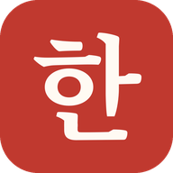

# KorTrainer

**A Korean self-study trainer: from the first letter to TOPIK, on the phone and in the browser.**

[](https://dotnet.microsoft.com/)
[](https://dotnet.microsoft.com/apps/aspnet/web-apps/blazor)
[](https://dotnet.microsoft.com/apps/maui)
[](https://learn.microsoft.com/ef/core/)
[](#development)
[](#quick-start)
[](LICENSE)

Russian interface · English code · romanization off by default: you learn to read Hangul without crutches

</div>

---

<table>
  <tr>
    <td align="center">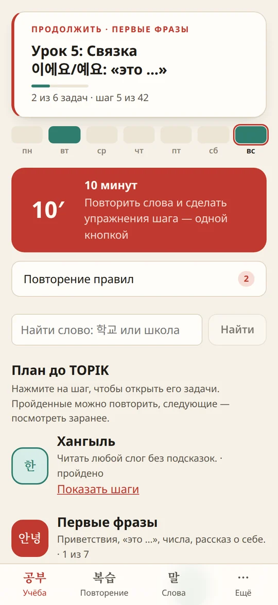<br /><sub><b>Home</b>: continue, 10 minutes, due checks</sub></td>
    <td align="center">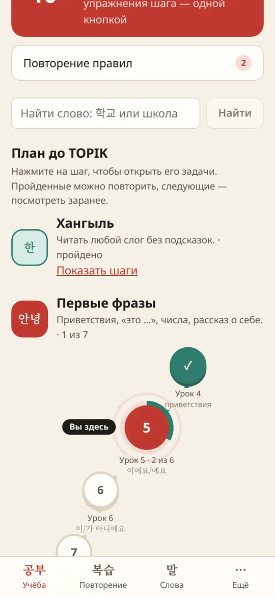<br /><sub><b>The plan</b>: 74 self-paced steps</sub></td>
    <td align="center">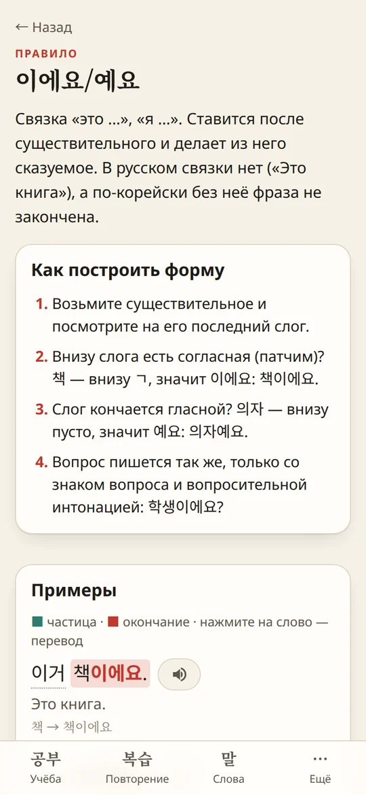<br /><sub><b>Rule first</b>: grammar in colour</sub></td>
    <td align="center">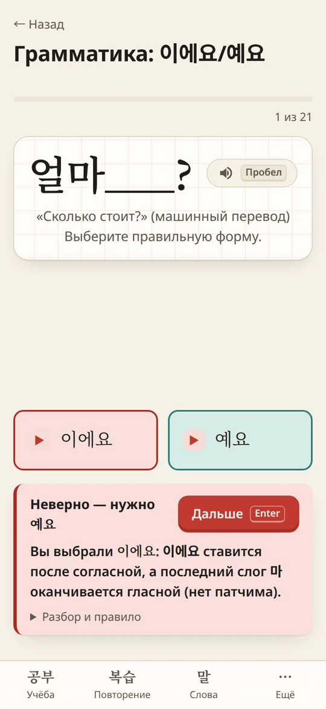<br /><sub><b>Every mistake explained</b></sub></td>
  </tr>
  <tr>
    <td align="center">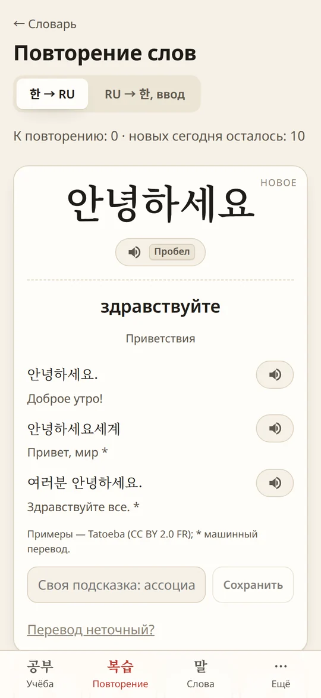<br /><sub><b>Spaced repetition</b> with examples</sub></td>
    <td align="center">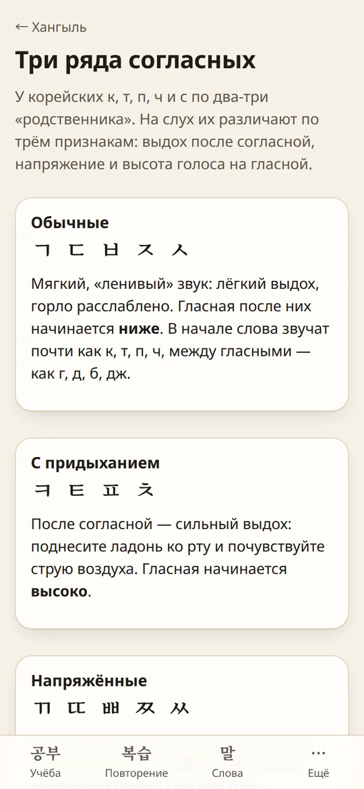<br /><sub><b>Hangul</b>: plain, aspirated, tense</sub></td>
    <td align="center">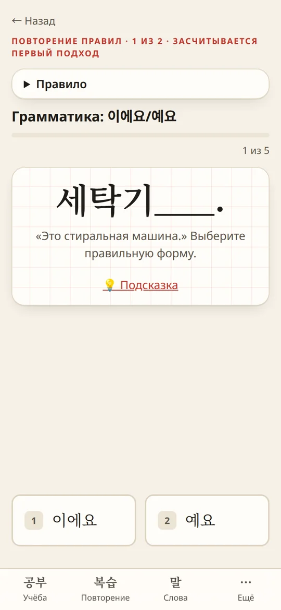<br /><sub><b>Rule checks</b> on a schedule</sub></td>
    <td align="center">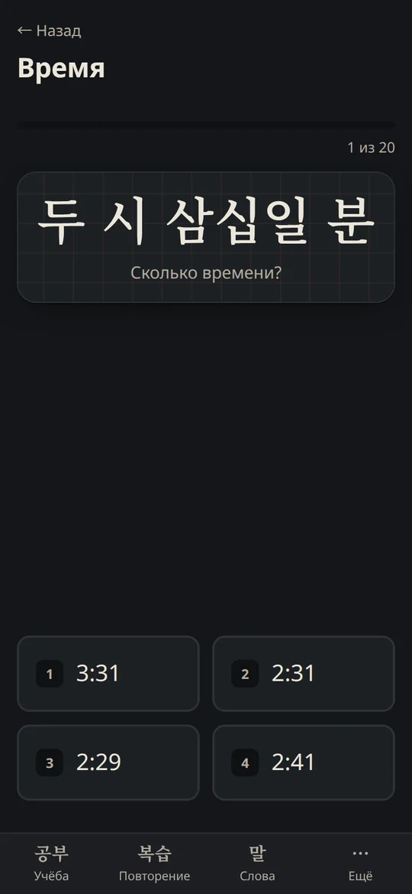<br /><sub><b>Numbers and time</b>, dark theme</sub></td>
  </tr>
</table>

<p align="center">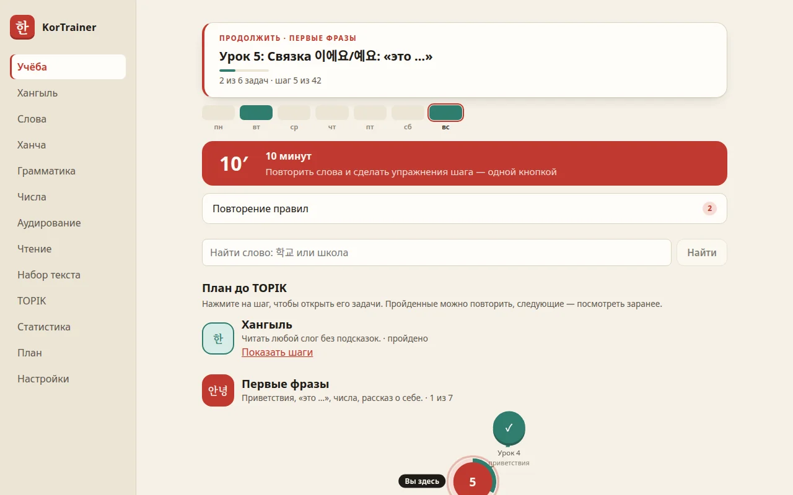</p>

## Contents

- [Why](#why)
- [What it teaches](#what-it-teaches)
- [Under the hood](#under-the-hood)
- [Architecture](#architecture)
- [Quick start](#quick-start)
- [Speech](#speech)
- [Development](#development)
- [Study plan](#study-plan)
- [Data sources and licences](#data-sources-and-licences)
- [API](#api)
- [License](#license)

## Why

I am preparing for TOPIK in spring 2027 on my own, and wanted one tool that walks the whole way: Hangul,
first phrases, the TOPIK I vocabulary and grammar, then TOPIK II writing. It should also check my answers
properly instead of only flipping cards. KorTrainer is that tool, and a portfolio project in C#: clean
architecture, a pure domain model with property-style tests, one Blazor UI shared by a web app and a native
Android app.

## What it teaches

### 🗺️ A plan that waits for you

- **74 self-paced steps towards TOPIK I**: three Hangul lessons, seven lessons of first phrases, then small blocks
  of 50 new words. Most blocks bring one new grammar topic, and the rest review it (that is where telling the time
  and paying come in). A block takes about five days at ten new words a day and 30–40 minutes of study. Nothing
  moves forward because days pass; a step is done when its tasks are.
- **Practice rotates** so every block stays short: graded texts, listening, saying words and phrases aloud,
  hanja roots from level 1 block 5, and TOPIK I reading items from block 8 onwards.
- **A finish line**: a mock TOPIK I (40 reading and 30 listening items, no writing, as in the real exam), then
  «Слабые места» and «Последняя неделя». TOPIK II preparation comes after the exam.
- **A gentle time guide** on the map: at your recent pace, roughly when each level's words are reached. It is
  a guide, never a deadline.
- **Every task is done in the app**, and progress is counted from your answers. Lesson tasks open one after
  another: new words → the rule → the drill → listening → saying words aloud → review.
- **«10 минут»** starts a short session with one tap: due cards, due mistakes, a due rule check, the step's
  next drill and the weakest topic.
- **Gentle by design**: the home screen shows the last seven days, not a streak. Reminders never say you are
  "behind".

### 한 Hangul

- Letter ↔ sound with Russian approximations; building and splitting syllables; the 7 final sounds.
- **The three consonant series** (가/카/까, 다/타/따, …): listen, compare, then drill one row.
- Pronunciation rules (연음, nasalization, tensification, …) with a word analyzer that explains them.
- **Timed reading** in milliseconds per syllable. Read aloud and speech recognition checks you.
- A **두벌식 keyboard trainer** that composes syllables like a real Korean IME.

### 📚 Vocabulary

- **~5,900 words**: ~350 hand-picked for the first lessons plus all three levels of the NIKL learner
  vocabulary list, introduced by frequency as the plan reaches them.
- **Anki-style SM-2** spaced repetition, swipe or `1`–`4` to grade, reverse cards with typed answers and a
  letter-level diff.
- **Memory aids** on every card: hanja roots (學 → 학교, 학생, 대학), up to three Tatoeba example sentences, your
  own note. Words you keep forgetting get their own page and drills.
- **«Перевод неточный?»**: flag a doubtful translation with your suggestion; the list notices when the deck
  is corrected later.

### ✍️ Grammar

- **29 TOPIK I topics**: particles (이/가, 은/는, 을/를, 와/과, (으)로), the polite and formal styles, past and
  future, negation, -고 / -아서 / -(으)니까, -고 싶다, -(으)ㄹ 수 있다, honorifics, -고 있다, -(으)면, and more.
- **The rule comes first**: meaning, how to build the form step by step, examples with particles and endings
  coloured, and the usual mistake. Tap any Korean word for its sound and meaning.
- **Distractors are real learner mistakes** (먹아요, 듣어요, 이워요, 먹읍니다, 갈께요), and each one says why it is
  wrong. A gap asks only for the part that changes: 책___ 아니에요 → 이 / 가.
- **Grammar in real sentences**: verb forms are found and blanked out in Tatoeba sentences built only from
  words you already know, plus 130 original sentences for topics Tatoeba barely covers.

### 🔢 Numbers

Sino-Korean and native numbers, counters (개, 명, 살, 권, 잔, 마리 …), clock time (native hours, Sino minutes) and
money, with an instant "how do I read this" converter.

### 🎧 Listening, speaking, reading

- Listening rises gradually: single words from lesson 4, then phrases, then shadowing whole sentences.
- **Dictation** and **shadowing** on sentences made of your words, checked syllable by syllable.
- **36 graded texts** with tap-to-translate (먹었어요 → 먹다) and comprehension questions.
- **135 original TOPIK I reading items** in the exam's formats, and a TOPIK II writing (51–54) timer with a
  원고지-style counter and saved drafts.

### 🔁 Review loops

| Loop | Schedule |
|---|---|
| Words | SM-2: learning steps, ease, lapses |
| Mistakes | a wrong answer comes back after 1, 3 and 7 days |
| Rules | grammar and number topics: a five-question check after 1, 3, 7, 14, 30 days, then every two months; 4 of 5 keeps it |
| Weak topics | topics under 85 % right in 30 days are drilled in «10 минут» |

### 📱 The phone app

The Android app is a real APK, not a web page. The database and all the logic live on the phone, so it works
offline. Neural speech for ~29,000 texts is bundled, a wrong answer gets a short buzz, and an evening
reminder and a home-screen widget show what is due. Once a week the app saves a backup to
`Downloads/KorTrainer`.

## Under the hood

- **Unicode syllable arithmetic.** `Syllable.Decompose` computes `initial = (c − 0xAC00) / 588`,
  `medial = (c − 0xAC00) % 588 / 28`, `final = (c − 0xAC00) % 28`. There are no tables, and a test round-trips
  all 11,172 syllables.
- **A pronunciation engine.** `Pronunciation.Pronounce("감사합니다")` → `[감사함니다]`, with the list of rules
  that fired; the drills' explanations come from it.
- **A conjugator with irregular classes.** ㅂ/ㄷ/르/ㅅ/ㅎ verbs, vowel harmony and contraction (가요, 봐요, 돼요),
  ㅡ-drop and ㄹ-drop. Its `ExplainedMistakes` produce the wrong forms learners actually write, each with the
  reason it is wrong.
- **`WordIndex`** links running text to the deck: it generates the stems every verb takes (가/갔/간/갈/가는) and
  matches the longest one, so 99 % of the words in the texts are found.
- **`HangulComposer`** reproduces a Korean keyboard's automaton (patchim moves to the next syllable,
  ㅗ+ㅏ → ㅘ, ㄹ+ㄱ → ㄺ), so the typing trainer needs no Korean layout.
- **Pure, deterministic schedulers and generators.** `SrsScheduler`, `MistakeSchedule` and `RuleSchedule`
  are functions over immutable records; every drill is generated from rules with an injected `Random`, so
  tests assert properties over hundreds of generated items.
- **Time done right.** Activity stores the learner's local date when it is written, so daily statistics are a
  plain `GROUP BY`. The clock (`TimeProvider`) is injected everywhere.

## Architecture

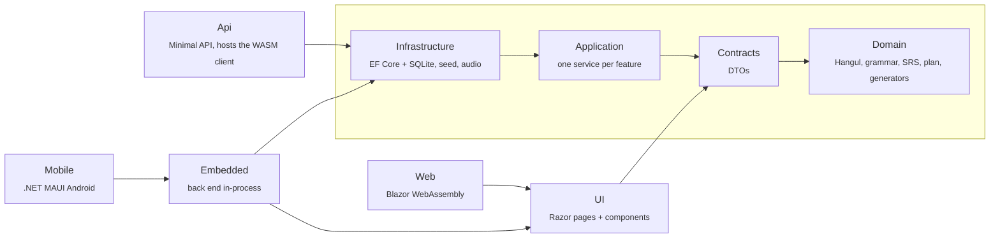

Dependencies point inwards and the Domain has none, so the same code runs on the server, in the browser and
on the phone. The pages only know `IKorTrainerApi`, `ISpeechOutput`, `IBackupExporter` and a few other
device services:

- **in the browser**, `HttpKorTrainerApi` calls the ASP.NET Core API and speech uses the Web Speech API;
- **on the phone**, `LocalKorTrainerApi` calls the application services directly (one DI scope per call),
  and speech uses the bundled clips or Android's text-to-speech.

| Project | What it holds |
|---|---|
| `KorTrainer.Domain` | Hangul (syllables, batchim, pronunciation, romanization), grammar (particles, conjugator, theory), numbers, SRS, the plan, exercise generators |
| `KorTrainer.Application` | use cases with validation (`ValidationFailedException` → 400, `NotFoundException` → 404) and the study clock |
| `KorTrainer.Infrastructure` | `AppDbContext`, migrations, the embedded deck, sentences and texts, Lingua Libre audio |
| `KorTrainer.Api` | Minimal API, RFC 7807 problem details, rate limiting, OpenAPI in development |
| `KorTrainer.UI` | every page and component, CSS with light and dark themes, JS interop |
| `KorTrainer.Web` · `KorTrainer.Mobile` | the two hosts: WebAssembly + PWA, and the Android app |

## Quick start

```bash
docker compose up --build          # or: podman compose up --build
```

Open <http://localhost:8080>. Data lives in the `kortrainer-data` volume.

> 🔒 KorTrainer is a single-user app **without authentication**: anyone who can reach the port can read and
> replace your progress. Run it on a trusted network, or bind it to localhost (`"127.0.0.1:8080:8080"`).

Without Docker (needs the .NET 10 SDK):

```bash
dotnet run --project src/KorTrainer.Api      # http://localhost:5116
```

**Android:** `tools/android/build-apk.sh` builds a signed release APK; setup, signing and moving your progress
between devices are in [`tools/android`](tools/android/README.md).

## Speech

| Source | Used for | Licence |
|---|---|---|
| [MeloTTS](https://github.com/myshell-ai/MeloTTS), generated once by [`tools/tts`](tools/tts/README.md) | every deck word, sentence, syllable and drill form, one consistent voice | MIT |
| [Lingua Libre](https://lingualibre.org) recordings | ~930 words by native speakers, when «Записи носителей» is on | CC0 / CC BY-SA, credited in the app |
| The device's voice | only text that was not generated, such as words typed into the analyzer | — |

Generated audio is not part of the repository; run the scripts in `tools/tts` to produce it.
`generate_edge.py` can voice the same texts with Microsoft's SunHi voice, which pronounces final consonants
more clearly, but its terms allow **personal use only**: never commit, publish or share that audio.

## Development

```bash
dotnet build                     # TreatWarningsAsErrors is on for every project
dotnet test                      # 1,056 tests: xUnit v3 on Microsoft.Testing.Platform, AwesomeAssertions
dotnet test -- --coverage --coverage-output-format cobertura
dotnet tool restore
dotnet ef migrations add <Name> -p src/KorTrainer.Infrastructure -s src/KorTrainer.Api -o Persistence/Migrations
```

| Test project | What it covers |
|---|---|
| `KorTrainer.Domain.Tests` | language rules and schedulers, property-style checks over generated drills |
| `KorTrainer.Application.Tests` | services against a migrated in-memory SQLite database with a fake clock |
| `KorTrainer.Api.Tests` | HTTP integration tests with `WebApplicationFactory` |
| `KorTrainer.Embedded.Tests` | the phone's in-process back end on a real SQLite file |

## Study plan

| Steps | Stage |
|---|---|
| lessons 1–3 | Hangul: basic letters → compound vowels and consonant series → batchim and 연음 |
| lessons 4–10 | first phrases: greetings, 이에요/예요, 이/가 아니에요, numbers, counters, introducing yourself |
| 16 blocks | level 1: about 860 words, a new grammar topic in most blocks (이/가, 을/를, -아/어요, 안, …), time and money, first texts, hanja |
| 14 blocks | level 2: endings (-고, -아서, -(으)니까, 못, -(으)면, …), TOPIK I reading in every other block, about 1,560 words |
| 3 steps | finish line: mock TOPIK I, weak spots, a light last week |
| 30 blocks | after the exam, towards TOPIK II: writing 51–54 and reading in turn, listening, about 3,060 words |

Blocks hold 50 new words each. Every step takes as long as it takes; the map shows roughly where your recent pace leads.

## Data sources and licences

- **«한국어 학습용 어휘 목록»**, the Korean Learner's Vocabulary List by the National Institute of Korean Language
  (국립국어원), 2003: headwords, parts of speech, hanja, levels and frequency, under
  [KOGL Type 1](https://www.kogl.or.kr/info/licenseType1.do). See [`tools/deck`](tools/deck/README.md).
- **Tatoeba** example sentences, [CC BY 2.0 FR](https://creativecommons.org/licenses/by/2.0/fr/), with ids and
  authors kept. Russian for sentences without a Tatoeba translation is machine-made and marked *.
- **Lingua Libre** recordings via Wikimedia Commons, CC0 and CC BY-SA 4.0. Every file's author is on the
  in-app `/credits` page.
- **Unihan** (© Unicode, Inc., Unicode License v3): English definitions as hints for the Russian hanja glosses.
- Reading texts, TOPIK I items and grammar sentences are original. Past papers are linked on
  [topik.go.kr](https://www.topik.go.kr), never copied.

> ⚠️ Many Russian translations in the deck are machine-generated. Flag doubtful ones in the app; fixes go into
> `Seed/words.json` or `tools/deck/*.tsv`, and the next start updates words in place without losing progress.

## API

<details>
<summary>Endpoints (click to expand)</summary>

| Method | Route | Purpose |
|---|---|---|
| GET · PUT | `/api/settings` | start date, time zone, romanization, theme, limits |
| GET | `/api/today?step=` | a plan step with its tasks and progress, the week, vocabulary |
| POST | `/api/plan/advance` · `/api/today/read` | finish the step (409 if it already changed) · mark a rule as read |
| GET | `/api/plan` · `/api/reminder` | stages and steps · whether to nudge today |
| GET | `/api/hangul/exercises/{type}?level=&count=&focus=` | Hangul drills |
| GET · POST | `/api/hangul/reading` · `/api/hangul/reading-trials` | timed reading and its results |
| GET | `/api/hangul/analyze?text=` · `/api/hangul/guide/{level}` | word analyzer · letter guide |
| GET · POST | `/api/vocab/queue` · `/api/vocab/reviews` | SRS queue and answers |
| GET | `/api/vocab/summary` · `/api/vocab/words` · `/api/vocab/topics` | vocabulary browser |
| GET · PUT | `/api/vocab/words/{id}/details` · `/api/vocab/words/{id}/note` | roots, examples, own note |
| PUT · DELETE · GET | `/api/vocab/words/{id}/flag` · `/api/vocab/flags` | doubtful translations |
| POST | `/api/vocab/words/{id}/study` | put a word into learning now |
| GET | `/api/vocab/hard` · `/api/vocab/hard/exercises/{type}` | hard words and their drills |
| GET | `/api/grammar/topics` · `/api/grammar/exercises/{type\|mixed\|sentences}` | grammar topics and drills |
| GET · POST | `/api/grammar/review` · `/api/grammar/review/{type}` | rule checks and their results |
| GET | `/api/numbers/exercises/{type}` · `/api/listening/exercises/{type}` | number and listening drills |
| GET | `/api/sentences/{dictation\|shadowing\|say-word}` | sentences and words made of yours |
| GET | `/api/mistakes/summary` · `/api/mistakes` | the mistakes queue |
| GET | `/api/hanja/roots` · `/api/hanja/roots/{char}` · `/api/hanja/exercises/{type}` | hanja roots |
| GET | `/api/texts` · `/api/texts/{id}` · `/api/topik/reading/{format}` | graded texts · TOPIK I reading |
| GET · POST | `/api/topik/writing` · `/api/topik/drafts` | TOPIK II writing guide and drafts |
| GET | `/api/typing/{level}` | keyboard trainer texts |
| GET | `/api/stats/overview` · `/daily` · `/forecast` · `/weak` | statistics |
| POST | `/api/attempts` · `/api/sessions` | activity log |
| GET | `/api/audio/words` · `/api/audio/{word}` · `/api/audio/tts?text=` | recordings and generated speech |
| GET · POST | `/api/progress/export` · `/api/progress/import` | JSON backup |

Errors are RFC 7807 problem details (`400` with field errors, `404` for unknown routes). In development the
OpenAPI document is at `/openapi/v1.json`.

</details>

## License

Code is released under the [MIT License](LICENSE). Bundled vocabulary, sentence and hanja data keep
their own licenses (KOGL Type 1, CC BY 2.0 FR, Unicode License v3) — see
[THIRD_PARTY_NOTICES.md](THIRD_PARTY_NOTICES.md) and [Data sources and licences](#data-sources-and-licences).
